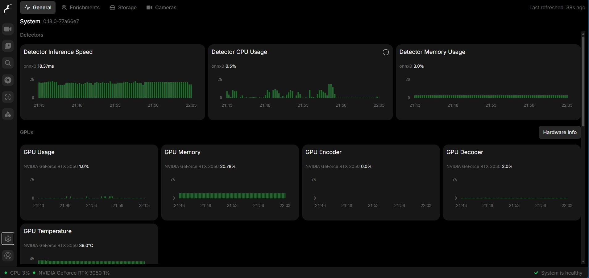
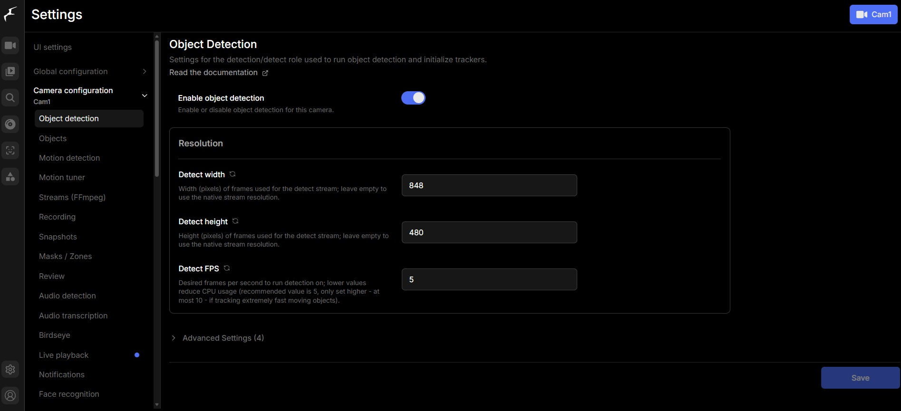
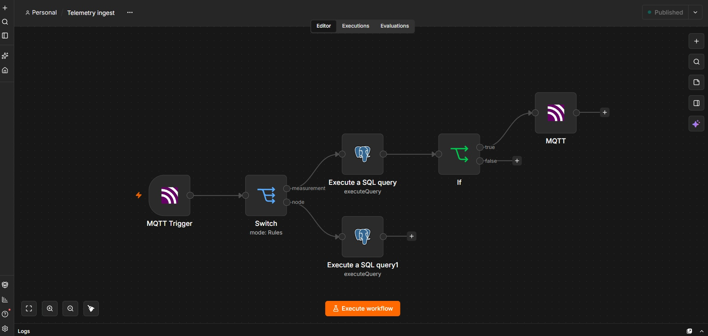
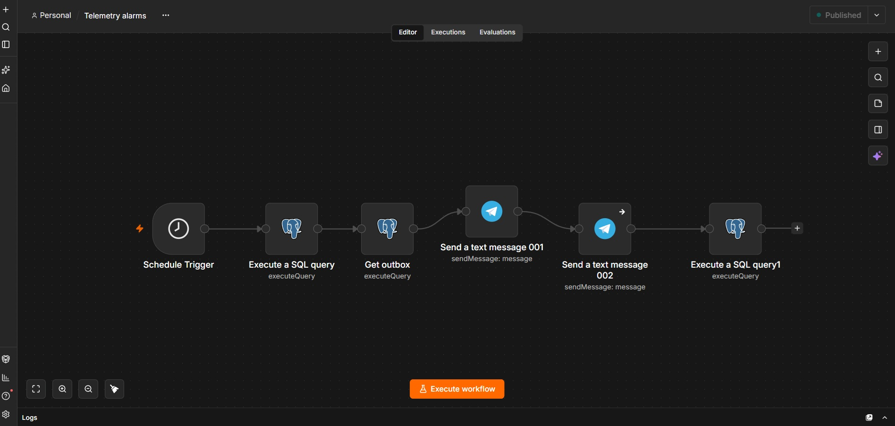
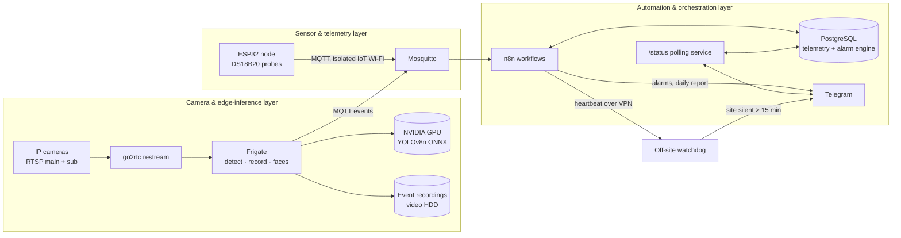

# Industrial Vision & Telemetry Platform (Edge AI)

An on-premises edge platform for a production site in Czechia: IP cameras are
ingested over RTSP, analysed on a local GPU (person detection and face
recognition with Frigate), recorded by event, and combined with ESP32 sensor
telemetry (freezer and room temperatures over MQTT) and n8n automation that
raises alarms in Telegram — all behind a segmented network with no inbound
ports open to the internet.

> **Status: bench-tested, site installation in progress — not production.**
> Everything below runs on the real server, cameras, router and sensor node
> on a bench; acceptance at the site is still ahead. Claims are tagged
> `owner-reported`, `locally verified` or `production verified` (nothing is
> production verified yet) — see [Evidence levels](#evidence-levels).

## My Role

**IoT / Edge AI engineering, end to end.** I designed and built this
platform: requirements and architecture, hardware selection, network
segmentation and firewall design, the camera/Frigate/go2rtc configuration,
the MQTT telemetry contract and database, the n8n automation and alerting,
the ESP32 firmware integration, and the operations side (backups, recovery
procedures, external watchdog). I ran every installation step on the real
hardware myself.

Analysis, implementation drafts and documentation were AI-assisted, using
Claude, Codex and ChatGPT as engineering tools. I retained ownership of the
architecture, requirements, validation and every deployment decision.

## Key Capabilities

- **Edge video analytics on a single GPU workstation** — two 5 MP cameras via
  Frigate's built-in go2rtc restream; person detection with YOLOv8n (ONNX) on
  an NVIDIA RTX 3050 at ~19 ms per inference; event-only recording with
  pre-capture and audio; native face recognition on bench test.
- **Sensor telemetry with an explicit contract** — ESP32 + DS18B20 probes
  publish versioned MQTT messages; ingestion is idempotent with an
  application-level acknowledgement back to the device.
- **Alarm engine in the database** — a PostgreSQL state machine
  (normal → pending → alarm, hysteresis on recovery, hourly reminders, stale
  data, node offline) feeding a notification outbox that n8n delivers to
  Telegram.
- **Segmented network as a design decision** — management, server, camera,
  office and IoT networks on a MikroTik router; cameras and IoT devices have
  no internet access; remote access only through an outbound VPN tunnel.
- **Operations built in, not bolted on** — external heartbeat watchdog,
  daily verified backups to two disks plus an encrypted off-site copy with
  automatic retry, weekly automated restore test, and one recovery
  procedure per hardware failure.

## Review in 5 Minutes

- [`samples/telemetry-db/`](samples/telemetry-db/README.md) — the telemetry
  schema and alarm state machine as a runnable sample: `docker compose`
  starts PostgreSQL, loads the schema and runs tests on synthetic data.
- [`samples/mqtt-contract/`](samples/mqtt-contract/README.md) — the
  device-to-platform MQTT contract (topics, payloads, idempotency,
  acknowledgement) with example messages.
- [`samples/esp32-telemetry/`](samples/esp32-telemetry/README.md) — a
  host-testable C rewrite of the device side: message building, per-probe
  sequences, RAM queue with eviction, application ACK handling.
- [`samples/n8n-workflows/`](samples/n8n-workflows/README.md) — sanitized,
  importable n8n workflows: ingestion with ACK, alarm delivery, daily
  report, heartbeat.
- [`samples/ops-backup/`](samples/ops-backup/README.md) — the backup,
  off-site and restore-verification tooling.
- [`portfolio/CASE_STUDY.md`](portfolio/CASE_STUDY.md) — how the platform was
  built and validated on a bench, decision by decision.

## Screenshots

UI structure only — no camera frames, no people, no identifiers.

### Frigate: GPU detector and system health

Person detection (YOLOv8n ONNX) on the RTX 3050 at ~18 ms per inference;
GPU memory, decoder and temperature during normal operation.

### Frigate: detection input per camera

Detection runs on the 848×480 substream at 5 fps; recording uses the main
stream.

### n8n: telemetry ingestion with acknowledgement

MQTT trigger → route by message type → store through a database function →
publish the acknowledgement back to the node.

### n8n: alarm delivery from the outbox

Every 5 minutes: evaluate the alarm state machine in the database → read
unsent outbox rows → deliver to the owner and a second recipient → mark sent.

## Business Problem

A production site needs to see what happens at entrances and exits, in the
production and packing halls and at the freezer rooms, and needs to know —
day and night — when a freezer warms up. Commercial cloud CCTV would push
video of employees to a third party and still would not watch the freezers;
a stand-alone NVR would record everything but understand nothing.

The site needed one local system that:

- records **events, not hours of empty footage**, so 4–8 cameras fit a
  single disk with ≥ 50 days of retention;
- recognises people at selected doors (identity is a protected data domain,
  not ordinary metadata);
- watches freezer and room temperatures and alarms only on real deviations;
- tells someone off-site when the whole site goes dark;
- keeps video and biometrics on site, with no inbound internet exposure.

## What I Delivered

- Commissioned the edge server (Ubuntu, Docker, NVIDIA driver and container
  toolkit) and deployed PostgreSQL, Mosquitto, n8n and Frigate as pinned,
  health-checked containers.
- Designed the camera path: go2rtc restream inside Frigate, substream for
  detection and main stream for recording, dedicated low-privilege RTSP user
  on each camera, camera time from the router, camera cloud features off.
- Configured GPU person detection (YOLOv8n ONNX), event recording with
  pre-capture and AAC audio, 50-day event retention, MQTT events, and native
  face recognition for a bench test.
- Measured storage instead of guessing: ~1.6 GB/day for two cameras on the
  bench, ~1.3–1.7 Mbit/s average main-stream bitrate, and a capacity model
  by recorded hours per camera.
- Defined the MQTT telemetry contract, built the telemetry database
  (ingestion validation, calibration, 30-minute minima, alarm state machine,
  daily summary/CSV) and the n8n ingestion, alarm and daily-report
  workflows; integrated the ESP32 firmware through that contract.
- Added a Telegram command (`/status`) answered by a small polling service
  with an allow-list in the database — no webhook, no inbound port.
- Designed and configured the five-network segmentation and firewall on the
  router, a separate Wi-Fi access point for office and isolated IoT
  clients, and an outbound WireGuard tunnel for administration.
- Built operations: an external heartbeat watchdog, BIOS power-on after
  power loss, daily backups with integrity checks, encrypted off-site copies
  with retry, router configuration export without secrets, and per-failure
  recovery procedures.

## What Is Upstream vs Custom

| Layer | Origin |
| --- | --- |
| Frigate (with built-in go2rtc), YOLOv8n model, Mosquitto, PostgreSQL, n8n | **Upstream open-source** — selected, configured and integrated by me, not written by me |
| Camera, detection, recording, retention and face-recognition configuration | **Custom** configuration |
| MQTT telemetry contract | **Custom** design |
| Telemetry database: schema, validation, alarm state machine, reports, bot command handler | **Custom** SQL / PL/pgSQL |
| n8n workflows (ingestion + ACK, alarms, daily report, heartbeat) | **Custom** workflows |
| Report/archive scripts, bot polling service, backup and restore tooling | **Custom** Bash + systemd |
| ESP32 firmware | **Owner's own firmware**, extended for MQTT (see [ESP32 case study](portfolio/ESP32_CASE_STUDY.md)) |
| Network segmentation, firewall rules, VPN design | **Custom** design on MikroTik RouterOS |

## Architecture

Details: [docs/ARCHITECTURE.md](docs/ARCHITECTURE.md). Diagram sources in
[`diagrams/`](diagrams/).

## Evidence levels

| Level | Meaning here |
| --- | --- |
| `owner-reported` | I ran the step or test on the real bench hardware and recorded the output |
| `locally verified` | Checked directly on the server/router by command output or configuration read-back |
| `production verified` | Verified in operation at the site — **nothing yet** |

The bench uses the real site hardware; the site itself (cabling, final
camera positions, lighting, site internet) is not yet installed.

## Technology Stack

| Category | Technologies |
| --- | --- |
| Video / edge AI | Frigate 0.18 (TensorRT image), go2rtc, YOLOv8n ONNX, ONNX Runtime on NVIDIA GPU, FFmpeg |
| Messaging | MQTT (Eclipse Mosquitto 2.0) |
| Automation | n8n 2.x |
| Data | PostgreSQL 16 (PL/pgSQL), SQLite (Frigate) |
| Devices | TP-Link VIGI C250 cameras, ESP32 Audio Kit (ESP-IDF), DS18B20 1-Wire probes |
| Network | MikroTik hEX S (RouterOS 7), MikroTik hAP ac lite (RouterOS 6), VLANs, WireGuard |
| Server | HP Z2 Tower G5, Intel Core i5-10400F, NVIDIA RTX 3050 6 GB, SSD + 4 TB HDD |
| OS / runtime | Ubuntu Server, Docker Compose, NVIDIA Container Toolkit, systemd timers |
| Operations | Bash, age encryption, zstd, smartmontools, Telegram Bot API |

## Known Gaps / Next Steps

- **Site installation**: cabling, final camera positions and the site
  internet uplink are still ahead; the tunnel and watchdog must be
  re-verified from the site.
- **Face recognition** works on the bench but is not accepted: controlled
  passes, day vs infrared, and lighting at the doors are still to be
  measured on site. Enrollment of employees needs a legal basis first.
- **Storage** was measured on a quiet bench; it must be re-measured after a
  week of real operation.
- **Planned**: vehicle detection and licence-plate recognition on entrance
  cameras, up to 8 cameras, zones and masks, host firewall, a full restore
  rehearsal on separate hardware.
- No CI pipeline; changes are applied manually with checklists.

## Documentation Map

| Document | Contents |
| --- | --- |
| [docs/ARCHITECTURE.md](docs/ARCHITECTURE.md) | Layers, components, data flows, design principles |
| [docs/CAMERA_AND_EDGE_INFERENCE.md](docs/CAMERA_AND_EDGE_INFERENCE.md) | Camera ingestion, detection, recording, storage model, face-recognition boundaries |
| [docs/TELEMETRY_AND_AUTOMATION.md](docs/TELEMETRY_AND_AUTOMATION.md) | ESP32 → MQTT → PostgreSQL → n8n, alarm policy, reports, bot command |
| [docs/NETWORK_DESIGN.md](docs/NETWORK_DESIGN.md) | Segmentation and firewall as engineering decisions, remote access |
| [docs/OPERATIONS_AND_RECOVERY.md](docs/OPERATIONS_AND_RECOVERY.md) | Watchdog, backups, off-site copies, restore tests, failure procedures |
| [docs/DEPLOYMENT_OVERVIEW.md](docs/DEPLOYMENT_OVERVIEW.md) | Bench-to-site gates and the checklist approach |
| [docs/PROJECT_HISTORY.md](docs/PROJECT_HISTORY.md) | Timeline of the build |
| [portfolio/CASE_STUDY.md](portfolio/CASE_STUDY.md) | Main case study |
| [portfolio/ESP32_CASE_STUDY.md](portfolio/ESP32_CASE_STUDY.md) | Mini case: ESP32 temperature node |
| [samples/](samples/) | Runnable and inspectable sanitized samples |
| [NOTICE.md](NOTICE.md) | Third-party attribution |

## Repository Scope

This is a curated, sanitized portfolio repository, not a mirror of the
private project:

- no credentials, IP addresses, subnets, VPN endpoints or keys, device
  identifiers, site name or location;
- no video, snapshots, faces, recognition data or model weights;
- no personal data of employees or visitors;
- configuration appears only as sanitized samples or generic excerpts with
  placeholders.

## Contact

Author: Vladimir Vjatkin. For questions about the scope of this portfolio
repository, please open an issue or contact the repository owner directly.
